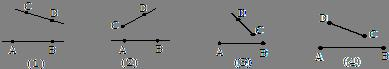

# Mathematics (Grade 4)

**ID**: fed0441d
**难度**: medium_hard
**题型**: multiple_choice

## 题目
下列四个图中的线段（或直线、射线）能相交的是（  ）。

A．（1）
B．（2）
C．（3）
D．（4）

## 解答

**答案**: A

1. Step1:分析（1），其中是两条直线，直线能无限延伸，延伸后会相交
2. Step2:分析（2），其中一条是射线向D端延长，另一条是直线，二者延伸后不会相交
3. Step3:分析（3），其中一条是只能向D端无限延伸的射线，另一条是线段，延长射线后不会相交
4. Step4:分析（4），其中两条都是线段，不能延伸，所以不会相交
5. Step5:综上，能相交的是（1），答案选A

## 知识点

**知识点**:
  - 

---
