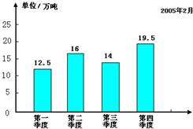

# Mathematics (Grade 4)

**ID**: 158b1b2d
**难度**: medium_hard
**题型**: short_answer

## 题目
下面是某化肥厂2004年产量统计图，根据图解答问题
（1）第四季度是第一季度的多少倍？
（2）2004年平均每月生产化肥多少万吨？（得数保留一位小数）

## 解答

**答案**: 1.56, 5.2

1. Step1:从统计图中可知第四季度产量为19.5万吨，第一季度产量为12.5万吨，用19.5除以12.5，即19.5÷12.5=1.56，得到第四季度是第一季度的倍数
2. Step2:先计算全年产量，将四个季度产量相加，12.5+16+14+19.5=62万吨，再用全年产量除以12，即62÷12≈5.2万吨，得到2004年平均每月生产化肥的量

## 知识点

**知识点**:
  - 以一当五（或以上）的条形统计图；平均数的含义及求平均数的方法；从统计图表中获取信息．

---
