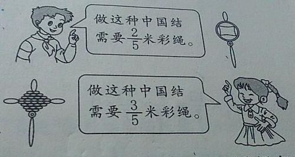

# Mathematics (Grade 4)

**ID**: 3729523c
**难度**: medium_hard
**题型**: short_answer

## 题目

   两种中国结各做24个，共需要彩绳多少米？

## 解答

**答案**: 42米

1. Step1:计算做24个第一种中国结所需彩绳长度，因为做一个第一种中国结需要$\frac{2}{5}$米彩绳，所以为$24	imes\frac{2}{5}$米
2. Step2:计算做24个第二种中国结所需彩绳长度，由于做一个第二种中国结需要$\frac{3}{5}$米彩绳，所以为$24	imes\frac{3}{5}$米
3. Step3:将做24个第一种中国结和24个第二种中国结所需彩绳长度相加，即$24	imes\frac{2}{5}+24	imes\frac{3}{5}$米
4. Step4:利用乘法分配律变形为$24×(\frac{2}{5}+\frac{3}{5})$米
5. Step5:先计算括号内的值，$\frac{2}{5}+\frac{3}{5}=1$
6. Step6:计算$24	imes1 = 24$米

## 知识点

**知识点**:
  - --

---
