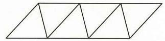

# Mathematics (Grade 4)

**ID**: 9b0d6feb
**难度**: medium_hard
**题型**: short_answer

## 题目
在图中找出已学过的图形，数一数每种图形各有几个

## 解答

**答案**: 9个, 6个, 4个

1. Step1:明确图中已学过的图形为三角形、平行四边形和梯形
2. Step2:数出图中平行四边形的个数为9个
3. Step3:数出图中三角形的个数为6个
4. Step4:数出图中梯形的个数为4个

## 知识点

**知识点**:
  - 九、总复习-第三课时  图形与几何-

---
