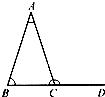

# Mathematics (Grade 4)

**ID**: b0da6511
**难度**: medium_hard
**题型**: short_answer

## 题目
如图，三角形ABC是等腰三角形，并且∠BAC=36°，求：∠ACD的度数．

## 解答

**答案**: 108°

1. Step1:根据等腰三角形两底角相等以及三角形内角和为180°，计算底角∠ACB的度数，即(180° - 36°)÷2 = 72°
2. Step2:因为∠ACD与∠ACB组成平角，平角为180°，所以计算∠ACD的度数为180° - 72° = 108°

## 知识点

**知识点**:
  - 线段与角的综合．

---
