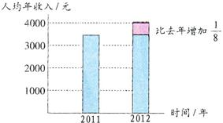

# Mathematics (Grade 4)

**ID**: c56feac6
**难度**: medium_hard
**题型**: short_answer

## 题目
幸福村农民2011年人均收入多少元？

## 解答

**答案**: 3555\\frac{5}{9}

1. Step1:根据题意，把2011年的人均收入看作单位'1'，可知2012年人均收入是2011年的1 + $rac{1}{8}$ = $rac{9}{8}$
2. Step2:已知2012年人均收入为4000元，求单位'1'（即2011年人均收入），根据求单位'1'用除法计算，列出算式4000÷（1 + $rac{1}{8}$）
3. Step3:计算4000÷（1 + $rac{1}{8}$），先算括号内1 + $rac{1}{8}$ = $rac{9}{8}$，再算4000÷$rac{9}{8}$ = 3555$rac{5}{9}$元，得出2011年人均收入为3555$rac{5}{9}$元

## 知识点

**知识点**:
  - 以一当五（或以上）的条形统计图．

---
