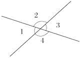

# Mathematics (Grade 4)

**ID**: d415882e
**难度**: medium_hard
**题型**: short_answer

## 题目
量出∠1的度数，并求出∠2、∠3、∠4的度数。

## 解答

**答案**: 50, 130, 50, 130

1. Step1:使用量角器测量∠1的度数，得到∠1 = 50°
2. Step2:根据平角为180°，计算∠2的度数，∠2 = 180° - ∠1 = 180° - 50° = 130°
3. Step3:根据平角为180°，计算∠3的度数，∠3 = 180° - ∠2 = 180° - 130° = 50°
4. Step4:根据平角为180°，计算∠4的度数，∠4 = 180° - ∠3 = 180° - 50° = 130°
5. Step5:将∠1、∠2、∠3、∠4的度数分别提取数值50、130、50、130

## 知识点

**知识点**:
  - 

---
