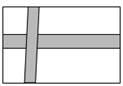

# Mathematics (Grade 4)

**ID**: d7a0e3f6
**难度**: medium_hard
**题型**: short_answer

## 题目
如图是一块长方形草地，长是20米，宽是12米，中间有两条石子路，一条是底是2米的平行四边形，一条是宽是2米的长方形。求草地的面积。

## 解答

**答案**: 180平方米

1. Step1:分析可知通过将两条石子路挤去，可把草地看作一个新的长方形。
2. Step2:计算新长方形的长，由原来长方形草地长20米减去平行四边形石子路的底2米，可得20 - 2 = 18米。
3. Step3:计算新长方形的宽，由原来长方形草地宽12米减去长方形石子路的宽2米，可得12 - 2 = 10米。
4. Step4:根据长方形面积公式，面积=长×宽，计算新长方形面积为18×10 = 180平方米，此即为草地面积。

## 知识点

**知识点**:
  - 

---
