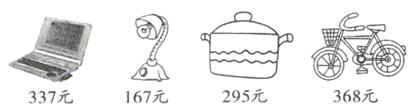

# Mathematics (Grade 4)

**ID**: ed7a5f34
**难度**: medium_hard
**题型**: short_answer

## 题目

（1）妈妈想给强强买一辆自行车和一盏台灯，需要多少钱？   
（2）购物满1000元送大礼包，妈妈至少要买哪几种商品才能获得礼包？

## 解答

**答案**: 535元, 一个学习机、一个汤锅和一辆自行车

1. Step1:已知一盏台灯价格为167元，一辆自行车价格为368元，根据加法运算，将两者价格相加，即167 + 368 = 535元，可得出买一辆自行车和一盏台灯所需的钱数。
2. Step2:已知学习机价格为337元，汤锅价格为295元，自行车价格为368元，先计算学习机和汤锅价格之和为337 + 295 = 632元，再将其与自行车价格相加，632 + 368 = 1000元，由此可知至少买一个学习机、一个汤锅和一辆自行车这几种商品才能获得礼包。

## 知识点

**知识点**:
  - 小学数学;数与代数;数的运算;整数的四则运算

---
