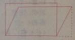

# Mathematics (Grade 4)

**ID**: f5c2a636
**难度**: medium_hard
**题型**: short_answer

## 题目
用木条制成这个长方形框,长是20cm,宽15cm,它的周长和面积各是多少?如果把它拉成平行四边形,周长和面积会怎样变化？

## 解答

**答案**: 70(cm), 300(平方厘米), 周长不变, 面积变小了

1. Step1:根据长方形周长公式，长方形周长=2×(长 + 宽)，已知长是20cm，宽15cm，可得周长为2×(20 + 15)=70(cm)
2. Step2:根据长方形面积公式，长方形面积=长×宽，可得面积为20×15 = 300(平方厘米)
3. Step3:分析拉成平行四边形后的周长，因为四条边长度不变，所以周长不变
4. Step4:分析拉成平行四边形后的面积，底不变，高变小，所以面积变小了

## 知识点

**知识点**:
  - --

---
