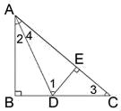

# Mathematics (Grade 4)

**ID**: f681ee62
**难度**: medium_hard
**题型**: short_answer

## 题目
如图，∠1＝65°，∠2＝25°，求∠3的度数。

## 解答

**答案**: 40°

1. Step1:在直角三角形ABD中，因为三角形内角和为180°，且∠B=90°，∠2 = 25°，所以∠ADB = 180° - 90° - 25° = 65°
2. Step2:因为∠1、∠ADB和∠EDC组成一个平角（平角为180°），∠1 = 65°，∠ADB = 65°，所以∠EDC = 180° - 65° - 65° = 50°
3. Step3:在直角三角形EDC中，因为三角形内角和为180°，且∠DEC=90°，∠EDC = 50°，所以∠3 = 180° - 90° - 50° = 40°

## 知识点

**知识点**:
  - 小学数学;图形与几何;平面图形;三角形;三角形的内角和

---
