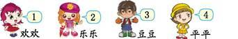

# Mathematics (Grade 4)

**ID**: 38b5301e
**难度**: medium
**题型**: multiple_choice

## 题目
四个小朋友在玩轮流报数游戏．

下面三个数中,(  )是乐乐报的．
$\begin{description}
\item A．35\item B．33\item C．34
\end{description}$

## 解答

**答案**: A

1. Step1:因为是四个小朋友轮流报数，所以报数是按照4个一循环。
2. Step2:用选项中的数除以4，看余数来判断。对于A选项35，35÷4 = 8余3，说明经过8个完整循环后，乐乐报数时是这一轮的第3个数，符合乐乐报数的情况。
3. Step3:对于B选项33，33÷4 = 8余1，说明经过8个完整循环后，是欢欢报数时是这一轮的第1个数，不符合乐乐报数。
4. Step4:对于C选项34，34÷4 = 8余2，说明经过8个完整循环后，是乐乐报数时是这一轮的第2个数，但通常一轮中乐乐是第2个报数，完整循环结束后下一轮乐乐应是第2个数开始新循环，此时的余数2对应的不是乐乐，不符合乐乐报数。
5. Step5:综上，答案是A。

## 知识点

**知识点**:
  - 小学数学;数与代数;数的运算;整数的四则运算;有余数的除法

---
