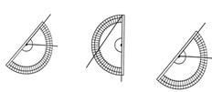

# Mathematics (Grade 4)

**ID**: 3a5e70e3
**难度**: medium
**题型**: multiple_choice

## 题目
下图中用量角器量角的方法不正确的（     ）。

①             ②            ③
A．①
B．②
C．③
D．①③

## 解答

**答案**: B

1. Step1:观察①图，量角器的中心与角的顶点重合，量角器的零刻度线与角的一条边重合，测量方法正确
2. Step2:观察②图，量角器的中心未与角的顶点重合，测量方法不正确
3. Step3:观察③图，量角器的中心与角的顶点重合，量角器的零刻度线与角的一条边重合，测量方法正确
4. Step4:综上，量角方法不正确的是②，答案选B

## 知识点

**知识点**:
  - 

---
