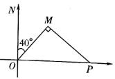

# Mathematics (Grade 4)

**ID**: 433a5771
**难度**: medium
**题型**: multiple_choice

## 题目
如下图，点M在点0北偏东40$^{0}$方向，那么点M在点P的（ ）方向。

$\begin{description}
\item A．北偏东50^{0}\item B．北偏西40^{0}\item C．北偏西50^{0}
\end{description}$

## 解答

**答案**: C

1. Step1:根据已知条件，点M在点O北偏东40°方向，可知∠MON = 40°（设ON为正北方向线）
2. Step2:因为三角形内角和为180°，在三角形OMP中，要确定点M在点P的方向，需看以P为观测点时与正北方向的夹角
3. Step3:由于直角为90°，可推出在以P为观测点时，点M与正北方向夹角为90° - 40° = 50°，且在北偏西方向
4. Step4:所以点M在点P的北偏西50°方向，答案选C

## 知识点

**知识点**:
  - 

---
