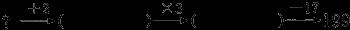

# Mathematics (Grade 4)

**ID**: 465054b4
**难度**: medium
**题型**: multiple_choice

## 题目
根据图示，计算“？“处的数，所列综合算式正确的是（ ）

A．（199+17）÷3-2
B．（1994+17）×3+2
C．（199-17）÷3-2
D．199-17÷3+2

## 解答

**答案**: A

1. Step1:从图示倒推，先考虑最后的计算结果是199，先进行的运算应该是逆运算，先有加17，那么倒推回去是减17，得到199 - 17
2. Step2:接着之前是乘3，倒推回去就是除以3，得到(199 - 17)÷3
3. Step3:最开始是加2，倒推回去就是减2，得到(199 - 17)÷3 - 2，与选项A一致

## 知识点

**知识点**:
  - 小学数学;数与代数;数的运算;整数的四则运算

---
