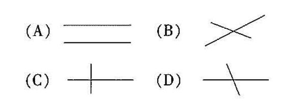

# Mathematics (Grade 4)

**ID**: 4789de8e
**难度**: medium
**题型**: multiple_choice

## 题目
下面互相垂直的一组直线是（    ）。

## 解答

**答案**: C

1. Step1:明确互相垂直的定义为两条直线相交成90度时，这两条直线互相垂直
2. Step2:分析选项A，两条直线平行，夹角为0°，不满足互相垂直的条件
3. Step3:分析选项B，两条直线相交，但夹角不是90°，不满足互相垂直的条件
4. Step4:分析选项C，两条直线的夹角是90°，满足互相垂直的条件
5. Step5:分析选项D，两条直线相交，但夹角不是90°，不满足互相垂直的条件
6. Step6:得出结论，互相垂直的一组直线是C

## 知识点

**知识点**:
  - 第五单元 平行四边形和梯形-垂直于平行（一）
-

---
