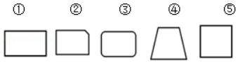

# Mathematics (Grade 4)

**ID**: 4962c8bf
**难度**: medium
**题型**: multiple_choice

## 题目
如图图形中（ ）是四边形．

A．①②③
B．①④⑤
C．①②④⑤

## 解答

**答案**: B

1. Step1:明确四边形的定义为由不在同一直线上的四条线段依次首尾相接围成的封闭的平面图形或立体图形。
2. Step2:观察图形①，它是由四条线段依次首尾相接围成的封闭图形，符合四边形定义。
3. Step3:观察图形②，其有一条边是曲线，不满足由四条线段围成的条件，不是四边形。
4. Step4:观察图形③，有一条边是曲线，不符合四边形定义，不是四边形。
5. Step5:观察图形④，是由四条线段依次首尾相接围成的封闭图形，是四边形。
6. Step6:观察图形⑤，是由四条线段依次首尾相接围成的封闭图形，是四边形。
7. Step7:综上，①④⑤是四边形，答案选B。

## 知识点

**知识点**:
  - 小学数学;图形与几何;平面图形;平面图形的认识及分类;四边形的分类及关系

---
