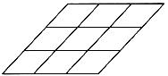

# Mathematics (Grade 4)

**ID**: 60ec2771
**难度**: medium
**题型**: multiple_choice

## 题目
数一数，图中一共有（     ）个平行四边形。

A．12
B．28
C．36

## 解答

**答案**: C

1. Step1:先数单个的小平行四边形，共9个
2. Step2:数由2个小平行四边形组成的平行四边形，横向有6个，纵向有4个，共10个
3. Step3:数由3个小平行四边形组成的平行四边形，横向有3个，纵向有2个，共5个
4. Step4:数由4个小平行四边形组成的平行四边形，共4个
5. Step5:数由6个小平行四边形组成的平行四边形，共2个
6. Step6:数由9个小平行四边形组成的平行四边形，共1个
7. Step7:将上述各类平行四边形的数量相加，9 + 10 + 5 + 4 + 2 + 1 = 36个
8. Step8:得出答案为36个，对应选项C

## 知识点

**知识点**:
  - 小学数学;图形与几何;平面图形

---
