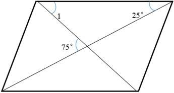

# Mathematics (Grade 4)

**ID**: 6dfa159b
**难度**: medium
**题型**: multiple_choice

## 题目
下图中,∠1=(  ) 

A．25°
B．45°
C．50°
D．100°

## 解答

**答案**: C

1. Step1:根据三角形内角和为180°，先看包含25°角和75°角的三角形，其第三个角的度数为180° - 25° - 75° = 80°。
2. Step2:因为平行四边形的对角线将其分成两个三角形，且平行四边形对边平行，所以与∠1相邻的角和包含25°角和75°角的三角形的第三个角互补，这个相邻角为180° - 80° = 100°。
3. Step3:在包含∠1的三角形中，另一个角与25°角是对顶角，对顶角相等，所以这个角为25°。
4. Step4:再根据三角形内角和为180°，计算∠1的度数，∠1 = 180° - 100° - 25° = 50°，所以答案选C。

## 知识点

**知识点**:
  - 小学数学;图形与几何;平面图形;三角形;三角形的内角和

---
