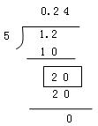

# Mathematics (Grade 4)

**ID**: 8fdfc928
**难度**: medium
**题型**: multiple_choice

## 题目
如图的计算，方框里的20表示（   ）。

A．20个一
B．20十分之一
C．20个百分之一
D．20个千分之一

## 解答

**答案**: C

1. Step1:观察竖式，1.2÷5，1除以5不够除，用12个十分之一除以5，商2余2，这里余下的2表示2个十分之一，也就是0.2。
2. Step2:把0.2看作20个百分之一，继续除，所以方框里的20表示20个百分之一。
3. Step3:逐一分析选项，A选项20个一是20，不符合；B选项20个十分之一是2，不符合；C选项20个百分之一是0.2，符合；D选项20个千分之一是0.02，不符合，所以答案选C。

## 知识点

**知识点**:
  - 小学数学;数与代数;数的运算;小数的四则运算;小数的除法

---
