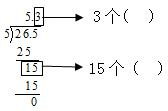

# Mathematics (Grade 4)

**ID**: a1f477ca
**难度**: medium
**题型**: multiple_choice

## 题目
如图竖式所列，（ ）里面的数分别表示什么？下列说法正确的是（ ）

A．分别表示3个0.1和15个1
B．分别表示3个1和15个0.1
C．分别表示3个0.1和15个0.1
D．分别表示3个0.1和15个0.01

## 解答

**答案**: C

1. Step1:分析竖式中 3 所在的数位，3 在十分位上，所以表示 3 个 0.1
2. Step2:分析竖式中 15 中 5 所在的数位，5 在百分位上，15 表示 15 个 0.01
3. Step3:逐一分析选项，A 选项中 15 个 1 错误；B 选项 3 个 1 错误，15 个 0.1 错误；C 选项 3 个 0.1 正确，15 个 0.1 错误；D 选项 3 个 0.1 正确，15 个 0.01 正确，所以答案是 D

## 知识点

**知识点**:
  - 小学数学;数与代数;数的认识;小数的认识;小数的读写、意义及分类;数的运算;小数的四则运算;小数的除法

---
