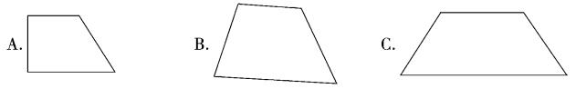

# Mathematics (Grade 4)

**ID**: a24a1a2a
**难度**: medium
**题型**: multiple_choice

## 题目
下图中，（）是等腰梯形。

## 解答

**答案**: C

1. Step1:明确等腰梯形的定义为两腰相等的梯形
2. Step2:观察选项A中的梯形，判断其两腰不相等
3. Step3:观察选项B中的梯形，判断其两腰不相等
4. Step4:观察选项C中的梯形，判断其两腰相等
5. Step5:得出只有选项C中的梯形是等腰梯形，答案为C

## 知识点

**知识点**:
  - 梯形的认识

---
