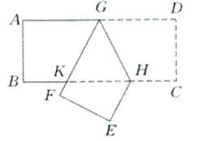

# Mathematics (Grade 4)

**ID**: aaabc641
**难度**: medium
**题型**: multiple_choice

## 题目
把长方形纸折叠，使CD边落在EF处，折痕为GH（如下图）。梯形GHEF和梯形ABHG的面积分别是16cm²与20cm²。长方形的面积是（  ）cm²。

A．40
B．36
C．不确定

## 解答

**答案**: B

1. Step1:根据折叠的性质可知，梯形GHEF的面积等于梯形GHDC的面积，都为16cm²。
2. Step2:已知梯形ABHG的面积是20cm²。
3. Step3:长方形的面积等于梯形ABHG的面积加上梯形GHDC的面积，即20 + 16 = 36cm²。

## 知识点

**知识点**:
  - 小学数学;图形与几何;图形的拼组;图形的折叠问题

---
