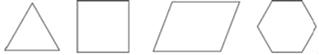

# Mathematics (Grade 4)

**ID**: b6b0d9c8
**难度**: medium
**题型**: multiple_choice

## 题目
如图的图形中，有（  ）个可由两个相同的梯形拼成．

$\begin{description}
\item A．1\item B．2\item C．3\item D．4
\end{description}$

## 解答

**答案**: C

1. Step1:明确两个相同的梯形可以拼成平行四边形
2. Step2:观察图中的图形，三角形不能由两个相同的梯形拼成
3. Step3:正方形不能由两个相同的梯形拼成
4. Step4:平行四边形可以由两个相同的梯形拼成
5. Step5:正六边形可以由两个相同的梯形拼成
6. Step6:统计能由两个相同梯形拼成的图形个数为2个，答案选B

## 知识点

**知识点**:
  - 小学数学;图形与几何;图形的拼组;平面图形的切拼

---
