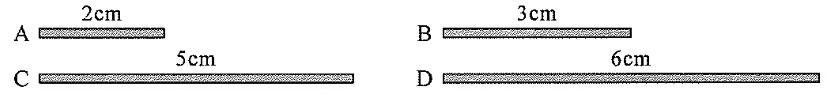

# Mathematics (Grade 4)

**ID**: bb453183
**难度**: medium
**题型**: multiple_choice

## 题目

 A  2cm  B  3cm C 5cm  D 6cm
 从上面的小棒中选3根，能围成一个三角形的是（    ）。
 ①A、B、C
 ②A、B、D
 ③B、C、D

## 解答

**答案**: C

1. Step1:明确三角形三边关系为任意两边之和大于第三边，任意两边之差小于第三边
2. Step2:分析①选项，A、B、C对应的长度为2cm、3cm、5cm，计算2 + 3 = 5，不满足任意两边之和大于第三边，所以①不能围成三角形
3. Step3:分析②选项，A、B、D对应的长度为2cm、3cm、6cm，计算2 + 3 = 5＜6，不满足任意两边之和大于第三边，所以②不能围成三角形
4. Step4:分析③选项，B、C、D对应的长度为3cm、5cm、6cm，计算3 + 5 = 8＞6，3 + 6 = 9＞5，5 + 6 = 11＞3，满足任意两边之和大于第三边，所以③能围成三角形

## 知识点

**知识点**:
  - 三角形、平行四边形和梯形

---
