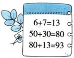

# Mathematics (Grade 4)

**ID**: ce2916de
**难度**: medium
**题型**: multiple_choice

## 题目
小亮在计算一道加法算式时，使用了下面的方法。他计算的加法算式是(    )。

A．66＋37
B．56＋37
C．65＋73
D．56＋47

## 解答

**答案**: B

1. Step1:观察小亮的计算过程，先计算6 + 7 = 13，再计算50 + 30 = 80，最后计算80 + 13 = 93，说明两个加数个位分别是6和7，十位分别是5和3。
2. Step2:逐一分析选项，A选项66＋37，个位是6和7，十位是6和3，不符合。
3. Step3:B选项56＋37，个位是6和7，十位是5和3，符合。
4. Step4:C选项65＋73，个位是5和3，不符合。
5. Step5:D选项56＋47，十位是5和4，不符合。
6. Step6:综上，答案是B。

## 知识点

**知识点**:
  - 小学数学;数与代数;数的运算;整数的四则运算;整数的加法、减法

---
