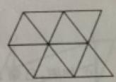

# Mathematics (Grade 4)

**ID**: e0668803
**难度**: medium
**题型**: multiple_choice

## 题目
如图，由8个全等的正三角形拼成的图形，其中平行四边形的个数共有（  ）
 A．12个
 B.  10个
 C．8个
 D.  6个

## 解答

**答案**: B

1. Step1:明确题目要求是找出由8个全等正三角形拼成图形中平行四边形的个数
2. Step2:依据平行四边形的判定定理，即两组对边分别相等的四边形是平行四边形来进行判断
3. Step3:对图形中的平行四边形进行逐一观察和计数
4. Step4:得出平行四边形的个数为10个，所以答案选B

## 知识点

**知识点**:
  - 

---
