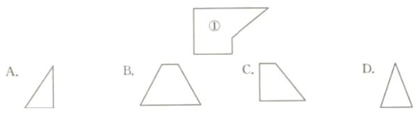

# Mathematics (Grade 4)

**ID**: f8cea217
**难度**: medium
**题型**: multiple_choice

## 题目
图形①是一个长方形少了一块后得到的，它少的应该是（）。

## 解答

**答案**: C

1. Step1:明确图形①是长方形少了一块得到的
2. Step2:根据长方形特征，判断少的一块是直角梯形
3. Step3:在选项中找出直角梯形，即选项C

## 知识点

**知识点**:
  - 长、正方形的认识

---
