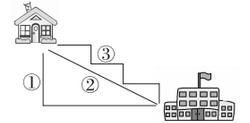

# Mathematics (Grade 4)

**ID**: ffdd9c3c
**难度**: medium
**题型**: multiple_choice

## 题目
明明从家到学校有3条路可以走（如下图）哪条路最近？

## 解答

**答案**: B

1. Step1:明确问题是找出从家到学校的最近路线
2. Step2:依据两点之间线段最短的性质
3. Step3:观察发现①和③是折线，②是连接家到学校的线段
4. Step4:得出②是最近路线

## 知识点

**知识点**:
  - 线段、直线与射线的认识;最短路线问题(奥数)

---
