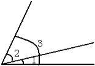

# Mathematics (Grade 4)

**ID**: 05f8ed95
**难度**: medium
**题型**: short_answer

## 题目
已知∠1=20°，∠3=75°，     求∠2的度数．

## 解答

**答案**: 55°

1. Step1:明确已知条件，∠1=20°，∠3=75°
2. Step2:根据∠2的度数等于∠3 - ∠1这一关系
3. Step3:计算∠2的度数，即75° - 20° = 55°

## 知识点

**知识点**:
  - 角的度量．

---
