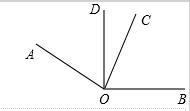

# Mathematics (Grade 4)

**ID**: 408f09a6
**难度**: medium
**题型**: short_answer

## 题目
如图所示，已知∠AOB=150°，∠AOC=∠BOD=90°，求∠DOC的度数．

## 解答

**答案**: 30°

1. Step1:根据已知条件∠AOB=150°，∠AOC=90°，通过∠BOC=∠AOB - ∠AOC计算出∠BOC的度数，即∠BOC=150° - 90°=60°
2. Step2:已知∠AOC=90°，以及上一步计算出的∠BOC=60°，通过∠DOC=∠AOC - ∠BOC计算出∠DOC的度数，即∠DOC=90° - 60°=30°

## 知识点

**知识点**:
  - 角的度量

---
