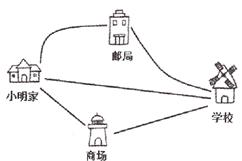

# Mathematics (Grade 4)

**ID**: 600795ec
**难度**: medium
**题型**: short_answer

## 题目
小明要从家去学校，走哪条路最近？为什么？

## 解答

**答案**: 中间的路最近, 因为两点之间所有连线中线段最短

1. Step1:明确小明从家去学校有三条路可走
2. Step2:根据两点之间所有连线中线段最短这一原理
3. Step3:观察三条路，发现只有中间的路是线段
4. Step4:得出中间的路最近的结论

## 知识点

**知识点**:
  - 小学数学;图形与几何;平面图形;直线、射线、线段;两点间线段最短与两点间的距离

---
