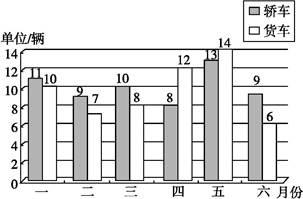

# Mathematics (Grade 4)

**ID**: 76ba8a11
**难度**: medium
**题型**: short_answer

## 题目
下面是某汽车公司2017年上半年销售轿车和货车情况统计图。
2017年上半年销售轿车和货车情况统计图
2017年6月

(1)上半年一共销售货车多少辆？
(2)上半年平均每个月销售轿车多少辆?

## 解答

**答案**: 57, 10

1. Step1:观察统计图，一月货车销售10辆，二月货车销售7辆，三月货车销售8辆，四月货车销售8辆，五月货车销售13辆，六月货车销售11辆，将各月货车销售量相加，即10 + 7 + 8 + 8 + 13 + 11 = 57辆，得出上半年一共销售货车57辆
2. Step2:观察统计图，一月轿车销售11辆，二月轿车销售9辆，三月轿车销售10辆，四月轿车销售12辆，五月轿车销售14辆，六月轿车销售9辆，先计算上半年轿车销售总量为11 + 9 + 10 + 12 + 14 + 9 = 65辆，再用总量除以6个月，即65÷6 = 10.83……，题目问的是平均每个月销售轿车多少辆，对10.83……取整得10辆

## 知识点

**知识点**:
  - 小学数学;统计和概率;统计;统计图;复式条形统计图

---
