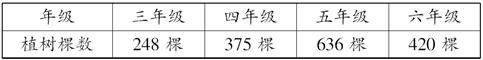

# Mathematics (Grade 4)

**ID**: 92874e70
**难度**: medium
**题型**: short_answer

## 题目
学校组织三到六年级学生植树，三年级有4个班，四年级有5个班，五年级有6个班，六年级有3个班。下面是三到六年级每个年级植树的情况。

（1）三年级平均每个班植树多少棵？
（2）你还能提出什么数学问题？并解答。

## 解答

**答案**: 62

1. Step1:根据题目可知三年级植树248棵，有4个班，要求三年级平均每个班植树的棵数，根据平均数的计算方法，用三年级植树总棵数除以班级数，即248÷4。
2. Step2:计算248÷4的结果为62棵，所以三年级平均每个班植树62棵。

## 知识点

**知识点**:
  - 小学数学;数与代数;数的运算;整数的四则运算

---
