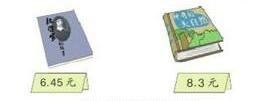

# Mathematics (Grade 4)

**ID**: c3e87c47
**难度**: medium
**题型**: short_answer

## 题目
小林买了下面两本书，一共花了多少钱？

 6.45元，                          8.3元

## 解答

**答案**: 14.75

1. Step1:明确题目是求两本书的总价，需将两本书的价格相加
2. Step2:已知两本书价格分别为6.45元和8.3元
3. Step3:进行加法运算，6.45 + 8.3 = 14.75元
4. Step4:得出一共花了14.75元，得到答案

## 知识点

**知识点**:
  - 小数的加法和减法;小数加减法

---
