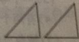

# Mathematics (Grade 4)

**ID**: cfd7c52e
**难度**: medium
**题型**: short_answer

## 题目
用两个相同的等腰直角三角形（如下图），可以拼成哪些三角形？哪些四边形？

## 解答

**答案**: 一个正方形, 一个平行四边形, 一个等腰直角三角形

1. Step1:考虑两个相同等腰直角三角形的拼接情况
2. Step2:当斜边对在一起时，可拼成一个正方形
3. Step3:当两条直角边对在一起时，可拼成一个平行四边形
4. Step4:当两条直角边对在一起时，还可拼成一个等腰直角三角形

## 知识点

**知识点**:
  - 

---
