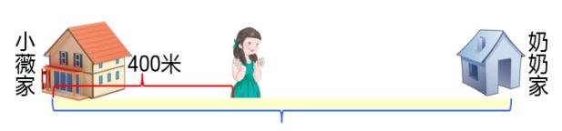

# Mathematics (Grade 4)

**ID**: f2b32737
**难度**: medium
**题型**: short_answer

## 题目
小薇家到奶奶家的路程约是1千米，小薇已经走了400米，还要走多少米？

## 解答

**答案**: 600米

1. Step1:将路程单位统一，因为1千米＝1000米
2. Step2:用总路程1000米减去已走的400米，即1000 - 400
3. Step3:计算得出结果为600米

## 知识点

**知识点**:
  - 小学数学;数与代数;数的运算;整数的四则运算;整数的加法、减法;图形与几何;测量;常见的长度单位及换算;长度单位的换算

---
