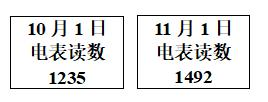

# Mathematics (Grade 4)

**ID**: f4742d40
**难度**: medium
**题型**: short_answer

## 题目
某地的电费收取办法规定如下：每月用电200千瓦时（含200千瓦时）以内的，每千瓦时收费0.55元；每月用电超过200千瓦时的，超过部分每千瓦时电加收0.1元。小强家10月份用电情况如图，他家10月份应付电费多少元？（电表读数单位：千瓦时）

## 解答

**答案**: 147.05

1. Step1:计算10月份用电量，用11月1日电表读数减去10月1日电表读数，即1492 - 1235 = 257千瓦时
2. Step2:计算200千瓦时以内的电费，200×0.55 = 110元
3. Step3:计算超过200千瓦时部分的电量，257 - 200 = 57千瓦时
4. Step4:计算超过200千瓦时部分的电费，57×(0.55 + 0.1)= 57×0.65 = 37.05元
5. Step5:计算10月份总电费，110 + 37.05 = 147.05元

## 知识点

**知识点**:
  - 小学数学;数与代数;数的运算;整数的四则运算

---
