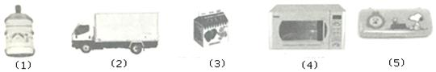

# Mathematics (Grade 5)

**ID**: 06c34060
**难度**: hard
**题型**: fill_in_the_blank

## 题目
填上合适的体积单位或容积单位（cm$^{3}$、dm$^{3}$、m$^{3}$、ml、L）

（1）矿泉水桶的容积约是18$\underline{\hspace{5em}}$      
（2）集装箱的体积约是40$\underline{\hspace{5em}}$      
（3）酸奶盒的容积约是240$\underline{\hspace{5em}}$      
（4）微波炉的体积约是$\underline{\hspace{5em}}$      
（5）文具盒的体积约是$\underline{\hspace{5em}}$      ．

## 解答

**答案**: L, m^3, ml, dm^3, cm^3

1. Step1:根据生活经验和对容积单位的认识，矿泉水桶容积较大，所以（1）处应填L
2. Step2:集装箱体积非常大，结合体积单位知识，（2）处应填m^3
3. Step3:酸奶盒容积较小，按照容积单位使用习惯，（3）处应填ml
4. Step4:微波炉体积适中，依据常见体积单位应用，（4）处应填dm^3
5. Step5:文具盒体积较小，根据体积单位选择，（5）处应填cm^3

## 知识点

**知识点**:
  - 根据情景选择合适的计量单位

---
