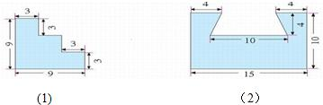

# Mathematics (Grade 5)

**ID**: 06d53f55
**难度**: hard
**题型**: fill_in_the_blank

## 题目
看图填空

（1）面积$\underline{\hspace{5em}}$
（2）面积$\underline{\hspace{5em}}$．

## 解答

**答案**: 54, 116

1. Step1:对于（1），将图形拆解为3个长方形，第一个长方形长9宽3，其面积为9×3 = 27；
2. Step2:（1）中第二个长方形长为9 - 3 = 6，宽为9 - 3 - 3 = 3，面积为6×3 = 18；
3. Step3:（1）中第三个长方形长3宽3，面积为3×3 = 9；
4. Step4:（1）中图形总面积为三个长方形面积之和，即27 + 18 + 9 = 54；
5. Step5:对于（2），先确定原图面积等于长方形面积减去梯形面积，长方形长15宽10，其面积为15×10 = 150；
6. Step6:（2）中梯形上底为15 - 4 - 4 = 7，下底为10，高为4，根据梯形面积公式可得其面积为[（15 - 4 - 4） + 10]×4÷2 = 17×4÷2 = 34；
7. Step7:（2）中图形总面积为长方形面积减去梯形面积，即150 - 34 = 116

## 知识点

**知识点**:
  - 组合图形的面积．

---
