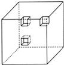

# Mathematics (Grade 5)

**ID**: 09ffffb6
**难度**: hard
**题型**: fill_in_the_blank

## 题目
如图，有一个边长为20厘米的大正方体，分别在它的角上、棱上、面上各挖掉一个大小相同的小立方体后，表面积变为2454平方厘米，挖掉的小立方体的棱长是$\underline{\hspace{5em}}$厘米．

## 解答

**答案**: 3

1. Step1:计算原来大正方体的表面积为20×20×6 = 2400平方厘米
2. Step2:分析挖掉小正方体后表面积的变化情况，角上挖掉表面积不变，棱上挖掉增加2个面，面上挖掉增加4个面，总共增加2 + 4 = 6个小正方体的面
3. Step3:计算增加的表面积为2454 - 2400 = 54平方厘米
4. Step4:计算小正方体一个面的面积为54÷6 = 9平方厘米
5. Step5:因为3×3 = 9，所以小正方体的棱长是3厘米

## 知识点

**知识点**:
  - 简单的立方体切拼问题；长方体和正方体的表面积．

---
