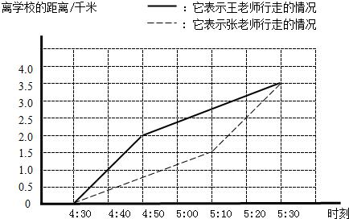

# Mathematics (Grade 5)

**ID**: 0aeacb88
**难度**: hard
**题型**: fill_in_the_blank

## 题目
下图描述了王老师和张老师从学校出发回家情况：

看图填一填：
（1）王老师从学校到家用的时间是$\underline{\hspace{5em}}$，行了$\underline{\hspace{5em}}$千米；她从学校出发，后40分钟行走的速度是$\underline{\hspace{5em}}$千米/时．
（2）张老师在5：10---5：30时间段行走的速度是多少千米/时？

## 解答

**答案**: 1小时, 3.5, 2.25, 6

1. Step1:计算王老师从学校到家用的时间，5时30分 - 4时30分 = 1小时
2. Step2:从图中可知王老师从学校到家行了3.5千米
3. Step3:将40分钟换算为小时，40分钟 = $\frac{2}{3}$小时
4. Step4:计算王老师后40分钟行走的路程，3.5 - 2.0 = 1.5千米
5. Step5:根据速度 = 路程÷时间，计算王老师后40分钟行走的速度，1.5÷$\frac{2}{3}$ = 2.25千米/时
6. Step6:计算张老师在5：10 - 5：30时间段所用的时间，5时30分 - 5时10分 = 20分钟 = $\frac{1}{3}$小时
7. Step7:计算张老师在5：10 - 5：30时间段行走的路程，3.5 - 1.5 = 2千米
8. Step8:根据速度 = 路程÷时间，计算张老师在5：10 - 5：30时间段行走的速度，2÷$\frac{1}{3}$ = 6千米/时

## 知识点

**知识点**:
  - 简单的行程问题；复式折线统计图．

---
