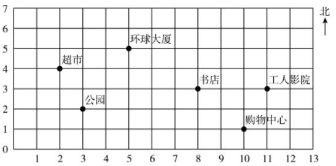

# Mathematics (Grade 5)

**ID**: 0d87332c
**难度**: hard
**题型**: fill_in_the_blank

## 题目
如图是某个地区一部分的平面示意图．
（1）用数对标出位置：环球大厦（ $\underline{\hspace{5em}}$ ， $\underline{\hspace{5em}}$ ），购物中心（ $\underline{\hspace{5em}}$ ， $\underline{\hspace{5em}}$ ）。
（2）图中（2，4）表示的位置是 $\underline{\hspace{5em}}$ 。
（3） $\underline{\hspace{5em}}$ 和 $\underline{\hspace{5em}}$ 在同一行上。
（4）张勇同学从公园门口出来到书店去，他应该怎么走？

## 解答

**答案**: 5, 5, 10, 1, 超市, 书店, 工人影城, 先向北走1格（或向东走5格），再向东走5格（或向北走1格）

1. Step1:根据数对中前面的数表示列，后面的数表示行，观察图中环球大厦所在列是第5列，行是第5行，得出环球大厦用数对表示为（5，5）
2. Step2:观察图中购物中心所在列是第10列，行是第1行，得出购物中心用数对表示为（10，1）
3. Step3:根据数对（2，4），找到图中第2列第4行的位置，确定是超市
4. Step4:观察图中各行，发现书店和工人影城都在第3行，所以书店和工人影城在同一行上
5. Step5:观察图中公园和书店的位置，公园在第3列第2行，书店在第8列第3行，得出从公园门口出来到书店去，可以先向北走1格（或向东走5格），再向东走5格（或向北走1格）

## 知识点

**知识点**:
  - 用数对确定位置;路线图

---
