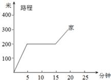

# Mathematics (Grade 5)

**ID**: 0e51acaf
**难度**: hard
**题型**: fill_in_the_blank

## 题目
看图填空：如图描述了红红放学回家的行程情况：
根据图回答如下问题：
(1)小红放学回家后是直接回家的吗？______
(2)从图中可以看出红红在路上逗留了______了多少分钟．
(3)红红家离学校约有______米．
(4)红红在回家的路上前5分钟平均每分钟走______米．

## 解答

**答案**: 没有, 10, 300, 40

1. Step1:观察折线统计图中折线的幅度，发现不是一条直接到家的直线，所以判断小红放学后不是直接回家，答案为没有
2. Step2:找到统计图中折线与时间轴相持平的线段，确定为逗留时间，用15 - 5 = 10，得出红红在路上逗留了10分钟
3. Step3:看到在距离学校300米处对应家的位置，可知红红家离学校约有300米
4. Step4:已知红红在前5分钟走了200米，用200÷5 = 40，得出红红在回家的路上前5分钟平均每分钟走40米

## 知识点

**知识点**:
  - 从统计图表中获取信息;简单的行程问题．

---
