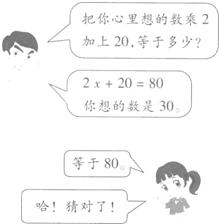

# Mathematics (Grade 5)

**ID**: 0f109030
**难度**: hard
**题型**: fill_in_the_blank

## 题目
猜数游戏．
（1）小兰心里想的数乘0减去2，等于47，这个数是$\underline{\hspace{5em}}$．
（2）小刚心里想的数减去2的6倍是126，这个数是$\underline{\hspace{5em}}$．
（6）小强心里想的数的2倍加上78是208，这个数是$\underline{\hspace{5em}}$．

## 解答

**答案**: 1.8, 129, 90

1. Step1:对于（1），设这个数是x，根据题意列出方程5x - 2 = 7，移项可得5x = 7 + 2，即5x = 9，两边同时除以5，解得x = 9÷5 = 1.8
2. Step2:对于（2），设这个数是x，根据题意列出方程x - 2×3 = 123，先计算2×3 = 6，方程变为x - 6 = 123，移项可得x = 123 + 6，解得x = 129
3. Step3:对于（3），设这个数是x，根据题意列出方程2x + 78 = 258，移项可得2x = 258 - 78，即2x = 180，两边同时除以2，解得x = 180÷2 = 90

## 知识点

**知识点**:
  - 方程的解和解方程．

---
