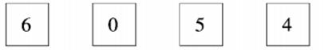

# Mathematics (Grade 5)

**ID**: 143352cf
**难度**: hard
**题型**: fill_in_the_blank

## 题目
从下面四张数字卡中取出三张，按要求组成三位数。

奇数： $\underline{\hspace{5em}}$ 
偶数： $\underline{\hspace{5em}}$ 
2的倍数： $\underline{\hspace{5em}}$ 
5的倍数： $\underline{\hspace{5em}}$ 
3的倍数： $\underline{\hspace{5em}}$ 
既是2的倍数又是3的倍数： $\underline{\hspace{5em}}$

## 解答

**答案**: 405, 465, 605, 645, 450, 406, 460, 456, 504, 540, 506, 560, 546, 564, 604, 640, 650, 654, 450, 406, 460, 456, 504, 540, 506, 560, 546, 564, 604, 640, 650, 654, 405, 450, 460, 465, 540, 560, 640, 605, 650, 645, 405, 450, 456, 465, 504, 540, 546, 564, 645, 654, 450, 456, 504, 540, 546, 564, 654

1. Step1:明确用6、0、5、4组成三位数的所有可能情况，有405、450、406、460、456、465、504、540、506、560、546、564、604、640、605、650、645、654。
2. Step2:根据奇数个位是1、3、5、7、9的特点，从所有三位数中找出奇数为405、465、605、645。
3. Step3:根据偶数的定义，除了奇数剩下的数即为偶数，得到偶数为450、406、460、456、504、540、506、560、546、564、604、640、650、654。
4. Step4:因为偶数都是2的倍数，所以2的倍数与偶数相同，为450、406、460、456、504、540、506、560、546、564、604、640、650、654。
5. Step5:根据5的倍数个位是0或5的特点，从所有三位数中找出5的倍数为405、450、460、465、540、560、640、605、650、645。
6. Step6:根据各个数位上的数相加的和是3的倍数，这个数就是3的倍数的特点，从所有三位数中找出3的倍数为405、450、456、465、504、540、546、564、645、654。
7. Step7:从2的倍数和3的倍数中找出相同的数，得到既是2的倍数又是3的倍数的数为450、456、504、540、546、564、654。

## 知识点

**知识点**:
  - 2、3、5、9的倍数特征;奇数偶数的认识及运算性质;整数的认识

---
