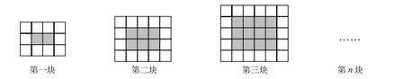

# Mathematics (Grade 5)

**ID**: 229b41a6
**难度**: hard
**题型**: fill_in_the_blank

## 题目
如图，用同样规格黑、白两色的正方形瓷砖铺设长方形地面，观察下列图形并解答有关问题。

（1）按以上的规律依次铺下去，铺设第四个长方形地面共用了 $\underline{\hspace{5em}}$ 块白瓷砖.
（2）假如铺某一块类似的长方形地面共用了72块瓷砖，那么它是第 $\underline{\hspace{5em}}$ 块长方形地面.
（3）若白瓷砖每块4元，黑瓷砖每块3元，在问题(2)中购买瓷砖共需花多少元？

## 解答

**答案**: 22, 6, 246

1. Step1:分析前三个图形规律，得出瓷砖总数=(n+2)×(n+3)，黑瓷砖的块数=n×(n+1)，白瓷砖的块数=(n+2)×(n+3)-n×(n+1)。
2. Step2:求第四个长方形地面白瓷砖数量，n=4，代入白瓷砖数量公式，即(4+2)×(4+3)-4×(4+1)=6×7 - 4×5=42 - 20=22块。
3. Step3:设第n个长方形地面共用72块瓷砖，根据瓷砖总数公式列方程(n+3)×(n+2)=72，因为72=8×9，所以n+3=9，n+2=8，解得n=6。
4. Step4:对于问题(2)中第6块长方形地面，先求黑瓷砖数量，n=6，代入黑瓷砖数量公式得6×(6+1)=42块，再求白瓷砖数量为72 - 42=30块。
5. Step5:根据白瓷砖每块4元，黑瓷砖每块3元，计算总花费为3×42+4×30=126+120=246元。

## 知识点

**知识点**:
  - 图形中的规律

---
