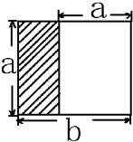

# Mathematics (Grade 5)

**ID**: 2619dfb1
**难度**: hard
**题型**: fill_in_the_blank

## 题目
如图所示，用含有字母的式子表示图中阴影部分的面积是 $\underline{\hspace{5em}}$ ；当b=10厘米，a=8厘米时，阴影部分的面积是 $\underline{\hspace{5em}}$ ．

## 解答

**答案**: ab-a^2平方厘米, 16平方厘米

1. Step1:根据图形可知阴影部分为长方形，其长为a，宽为(b - a)。
2. Step2:根据长方形面积公式S = 长×宽，可得阴影部分面积为a×(b - a)。
3. Step3:对a×(b - a)展开，得到ab - a^2，单位为平方厘米，所以第一空答案为ab - a^2平方厘米。
4. Step4:当b = 10厘米，a = 8厘米时，将其代入ab - a^2，得到8×10 - 8^2。
5. Step5:先计算8^2 = 64，再计算8×10 = 80。
6. Step6:计算80 - 64 = 16，单位为平方厘米，所以第二空答案为16平方厘米。

## 知识点

**知识点**:
  - 用字母表示数

---
