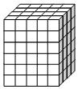

# Mathematics (Grade 5)

**ID**: 289fb435
**难度**: hard
**题型**: fill_in_the_blank

## 题目
如图，有一个正方体木块，棱长为1米，它的长、宽、高分别被分成了5、4、6块，共得到120块小长方体．那么这120块小长方体的表面积之和为$\underline{\hspace{5em}}$      平方米．

## 解答

**答案**: 45

1. Step1:计算小长方体的长，1÷5 = 1/5（米）
2. Step2:计算小长方体的宽，1÷4 = 1/4（米）
3. Step3:计算小长方体的高，1÷6 = 1/6（米）
4. Step4:根据长方体表面积公式S=(ab + ah + bh)×2，计算一个小长方体的表面积，即(1/5×1/4 + 1/5×1/6 + 1/4×1/6)×2=(1/20 + 1/30 + 1/24)×2 = 1/8×2 = 1/4（平方米）
5. Step5:计算120块小长方体的表面积之和，1/4×120 = 45（平方米）

## 知识点

**知识点**:
  - 长方体和正方体的表面积

---
