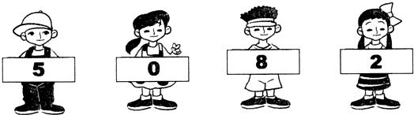

# Mathematics (Grade 5)

**ID**: 2941da8a
**难度**: hard
**题型**: fill_in_the_blank

## 题目
从下面4个数中选3个组成一个三位数，使它符合题目要求．

（1）奇数：$\underline{\hspace{5em}}$
（2）偶数：$\underline{\hspace{5em}}$
（3）5的倍数：$\underline{\hspace{5em}}$
（4）3的倍数：$\underline{\hspace{5em}}$
（5）既是2的倍数又是3的倍数：$\underline{\hspace{5em}}$
（6）既是2的倍数又是5的倍数：$\underline{\hspace{5em}}$
（7）既是5的倍数又是3的倍数：$\underline{\hspace{5em}}$．

## 解答

**答案**: 285, 825, 805, 205, 528, 582, 820, 850, 580, 520, 285, 825, 820, 850, 580, 520, 285, 825, 258, 852, 258, 852, 820, 850, 580, 520, 285, 825

1. Step1:根据奇数定义，在非零自然数中不是2的倍数的数叫做奇数，从5、0、8、2中选3个组成三位数，得到奇数为285、825、805、205
2. Step2:依据偶数定义，在自然数中是2的倍数的数叫做偶数，组成的偶数有528、582、820、850、580、520
3. Step3:按照5的倍数特征，个位是0或5的数是5的倍数，组成的5的倍数有285、825、820、850、580、520
4. Step4:根据3的倍数特征，各位上的数字之和能被3整除的数是3的倍数，组成的3的倍数为285、825、258、852
5. Step5:因为既是2的倍数又是3的倍数的数，个位上必须是偶数且各位上的数字之和是3的倍数，所以得到258、852
6. Step6:由于既是2的倍数又是5的倍数，个位上必须是0，组成的数是820、850、580、520
7. Step7:因为既是5的倍数又是3的倍数，这个数的个位是0或5且各位上的数字之和是3的倍数，得到285、825

## 知识点

**知识点**:
  - 奇数与偶数的初步认识；2、3、5的倍数特征；找一个数的倍数的方法．

---
